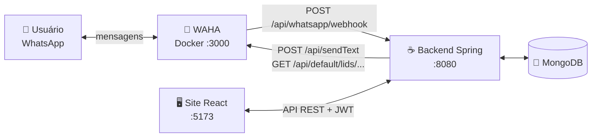
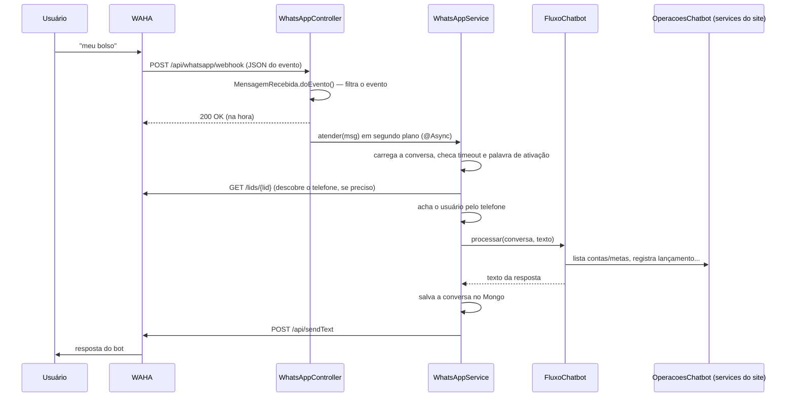
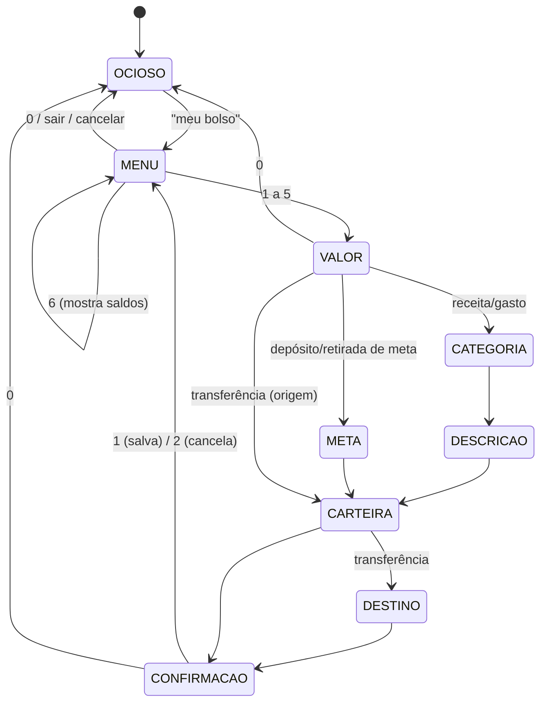

# 💬 Chatbot do WhatsApp — Meu Bolso

> Guia para devs: **como o chatbot funciona por dentro** e **como rodá-lo na sua máquina**.
> Para o passo a passo do ponto de vista do usuário, veja a página `/whatsapp` do site.

---

## 📚 Índice

- [1. Visão geral em 30 segundos](#1-visão-geral-em-30-segundos)
- [2. Arquitetura](#2-arquitetura)
- [3. O caminho de uma mensagem](#3-o-caminho-de-uma-mensagem)
- [4. As peças do código](#4-as-peças-do-código)
- [5. A conversa (máquina de estados)](#5-a-conversa-máquina-de-estados)
- [6. Dados gravados no MongoDB](#6-dados-gravados-no-mongodb)
- [7. Proteções para número pessoal](#7-proteções-para-número-pessoal)
- [8. Como rodar na sua máquina](#8-como-rodar-na-sua-máquina)
- [9. Testes](#9-testes)
- [10. Problemas comuns](#10-problemas-comuns)
- [11. Limitações conhecidas](#11-limitações-conhecidas)
- [12. Como adicionar uma nova opção ao menu](#12-como-adicionar-uma-nova-opção-ao-menu)

---

## 1. Visão geral em 30 segundos

- O usuário manda mensagem para um número de WhatsApp e o bot responde com um **menu numerado** (1 a 6).
- Quem conversa com o WhatsApp **não é o nosso backend**, e sim o **[WAHA](https://waha.devlike.pro/)** (WhatsApp HTTP API): um container Docker que "loga" num número pelo QR Code, igual ao WhatsApp Web.
- O WAHA avisa o backend de cada mensagem recebida (**webhook**). O backend decide a resposta e devolve chamando a API do WAHA.
- As operações (receita, gasto, metas, transferência) usam **os mesmos services do site**. Então as regras de negócio são as mesmas, e tudo aparece no site na hora.
- **Não precisa de túnel (ngrok) nem de conta na Meta.** WAHA e backend rodam na mesma máquina e conversam pela rede local.

> ⚠️ O WAHA **não é oficial**. Serve bem para o projeto e para apresentação. O WhatsApp pode bloquear números que se comportem como spam, então é recomendado sempre utilizar de forma natural, sempre com uma mensagem/conversa por vez.

---

## 2. Arquitetura



| Peça | Porta | Papel |
|---|---|---|
| WAHA (container `devlikeapro/waha`) | 3000 | Mantém a sessão do WhatsApp, recebe e envia mensagens. Tem um dashboard em `/dashboard`. |
| Backend (Spring Boot) | 8080 | Recebe o webhook, roda o fluxo da conversa e grava os dados. |
| MongoDB (Atlas ou local) | — | Guarda usuários, lançamentos e o estado das conversas. |
| Frontend (React) | 5173 | Não participa do bot. Só mostra os dados e a página `/whatsapp`. |

---

## 3. O caminho de uma mensagem



Em palavras:

1. **O WAHA recebe a mensagem** e faz um `POST` no webhook com um JSON parecido com este:
   ```json
   {
     "event": "message",
     "session": "default",
     "payload": {
       "id": "false_97199505543212@lid_3AE4...",
       "from": "97199505543212@lid",
       "fromMe": false,
       "body": "meu bolso",
       "hasMedia": false,
       "_data": { "type": "chat", "notifyName": "Fulano" }
     }
   }
   ```
2. **O controller filtra.** Só passa texto de conversa individual. Grupos (`@g.us`), status/stories (`status@broadcast`), canais (`@newsletter`), mensagens do próprio número (`fromMe`), mídia e outros tipos de mensagem são ignorados em silêncio.
3. **O controller responde 200 na hora** e entrega a mensagem para o `WhatsAppService` em segundo plano. Assim o WAHA não fica esperando nem reenvia o evento.
4. **O service identifica o usuário pelo telefone:**
   - O WhatsApp hoje costuma mandar o remetente como **LID** (`97199505543212@lid`), um id anônimo sem o número. O backend pergunta ao WAHA o número real em `GET /api/default/lids/{lid}`, que devolve algo como `{ "pn": "553197186768@c.us" }`.
   - Números antigos de MG chegam **sem o nono dígito** (`553197186768`). Por isso a busca compara o número com e sem o 9 (`Telefone.variantes()` + `UsuarioRepository.findByTelefoneIn()`).
5. **O fluxo decide a resposta**, conforme a etapa da conversa (veja a seção 5).
6. **O service salva a conversa** e **envia a resposta** com `POST /api/sendText`, para o mesmo `chatId` de onde a mensagem veio (funciona tanto com `@lid` quanto com `@c.us`).

---

## 4. As peças do código

Tudo do bot fica no pacote **`Projeto.MeuBolso.whatsapp`** (`Codigo/Backend/src/main/java/Projeto/MeuBolso/whatsapp/`), mais o controller.

| Classe | Responsabilidade |
|---|---|
| `controller/WhatsAppController` | Endpoint `POST /api/whatsapp/webhook`. Converte o JSON, filtra o evento e chama o service. A rota é pública no `SecurityConfig`, porque o WAHA não manda JWT. |
| `MensagemRecebida` | `record` com `id`, `chatId` e `texto`. O método `doEvento()` concentra **todos os filtros** do evento. |
| `WhatsAppService` | Orquestra: deduplica, aplica timeout e palavra de ativação, identifica o usuário, chama o fluxo, salva e responde. |
| `FluxoChatbot` | **A máquina de estados** da conversa: menu, perguntas, validações, resumo e confirmação. Não acessa banco nem rede. |
| `OperacoesChatbot` | Interface com as operações de negócio que o fluxo usa (listar contas e metas, registrar, transferir...). |
| `OperacoesChatbotImpl` | Implementação da interface em cima dos services do site: `ReceitaService`, `GastoService`, `MetaService` e `CarteiraService`. |
| `WahaClient` | Cliente HTTP do WAHA: `enviarTexto()` e `telefoneDoLid()`. Manda o header `X-Api-Key`. |
| `ConversaWhatsApp` + `ConversaWhatsAppRepository` | Estado da conversa no Mongo (coleção `conversas_whatsapp`). |
| `Opcao` | Item de lista numerada (id, nome, detalhe, valor), guardado na conversa para traduzir "2" no id certo. |
| `ValorMonetario` | Lê valores digitados: `50`, `25,90`, `25.90`, `R$ 1.234,56`. |
| `util/Telefone` | Normaliza o telefone (só dígitos, com DDI 55) e gera as variantes com e sem o nono dígito. |

**Por que `FluxoChatbot` não conhece Spring nem Mongo?** Para dar para testar a conversa inteira com uma implementação falsa de `OperacoesChatbot` (veja o `FluxoChatbotTest`), sem subir banco e sem Mockito.

**Services do site reaproveitados**

| Operação do bot | Método chamado |
|---|---|
| 1 Depósito (receita) | `ReceitaService.criar(...)` |
| 2 Gasto | `GastoService.criar(...)` |
| 3/4 Depósito e retirada de meta | `MetaService.movimentar(...)` |
| 5 Transferência entre contas | `CarteiraService.transferir(...)` (também grava em `transferencias`) |
| 6 Saldos e metas | Leitura das contas (`carteiras`) e das metas |

Os lançamentos feitos pelo bot ficam com o comentário/título **"Registrado pelo WhatsApp"**.

---

## 5. A conversa (máquina de estados)

Cada chat tem uma `ConversaWhatsApp` com uma **etapa** e os dados já informados.



**Fluxos de cada opção**

| Opção | Perguntas, em ordem |
|---|---|
| 1 Registrar depósito (receita) | valor → categoria → descrição → conta → confirmação |
| 2 Registrar gasto | valor → categoria → descrição → conta → confirmação |
| 3 Depositar em uma meta | valor → meta → conta de onde sai → confirmação |
| 4 Retirar de uma meta | valor → meta → conta para onde vai → confirmação |
| 5 Transferir entre contas | valor → conta de origem → conta de destino → confirmação |
| 6 Ver saldos e metas | mostra e continua no menu |

**Regras importantes**

- **Comandos globais:**
  - `0`, `sair` e `cancelar` **encerram** a conversa (volta para `OCIOSO`). O bot responde *Encerrado! Digite "meu bolso"...* e fica em silêncio até receber a palavra de ativação de novo.
  - `menu` volta ao menu sem encerrar.
- **Na confirmação:** `1` salva e `2` cancela só aquela operação.
- **Na descrição:** `-` usa o nome da categoria.
- **Listas numeradas:** a lista mostrada fica salva na conversa (`opcoes`). Assim, a resposta "2" é traduzida no id certo mesmo que algo mude no banco entre uma mensagem e outra.
- **Validações antes da confirmação:**
  - Saldo da conta quando o dinheiro sai dela (depósito em meta e transferência).
  - Valor guardado na meta, na retirada.
  - A transferência não oferece a conta de origem como destino.
- **Pré-requisitos:** se faltar cadastro (nenhuma conta, nenhuma meta, menos de duas contas para transferir), o bot avisa logo no menu, antes de pedir o valor.
- **Só contas bancárias:** receita, gasto, meta e transferência aceitam apenas contas. É a mesma regra do site: cartões e dinheiro em espécie ficam de fora.
- **Data:** sempre a de hoje, pelo `Clock` do Spring.
- **Erros de regra** (por exemplo, `ResponseStatusException` dos services) viram a mensagem "❌ Não foi possível concluir: *motivo*", e a conversa volta ao menu.
- **Timeout:** depois de 10 minutos sem mensagem, a operação em andamento é descartada (`WhatsAppService.TIMEOUT`).
- **Deduplicação:** o id da última mensagem processada fica salvo. Se o WAHA reenviar o mesmo evento, ele é ignorado.

---

## 6. Dados gravados no MongoDB

### `conversas_whatsapp` (`ConversaWhatsApp`) — novo

| Campo | Tipo | Descrição |
|---|---|---|
| `_id` | String | O `chatId` do WAHA (ex.: `97199505543212@lid`). |
| `usuarioId` | String | Usuário identificado pelo telefone (cache, para não consultar o WAHA a cada mensagem). |
| `etapa` | String (enum) | `OCIOSO`, `MENU`, `VALOR`, `CATEGORIA`, `DESCRICAO`, `META`, `CARTEIRA`, `DESTINO`, `CONFIRMACAO`. |
| `operacao` | String (enum) | `RECEITA`, `GASTO`, `META_DEPOSITO`, `META_RETIRADA`, `TRANSFERENCIA`, `SALDOS`. |
| `valor`, `categoria`, `descricao` | — | Dados já informados na operação. |
| `meta`, `carteira`, `destino` | `Opcao` | Escolhas já feitas (id + nome). |
| `opcoes` | Array de `Opcao` | Última lista numerada mostrada. |
| `ultimaMensagemId` | String | Para ignorar reenvios do mesmo evento. |
| `atualizadoEm` | Instant | Usado no timeout de 10 minutos. |

### `transferencias` (`Transferencia`) — novo

Histórico das transferências entre contas: `usuarioId`, `origemId`, `origemNome`, `destinoId`, `destinoNome`, `valor` e `data`. Aparece no extrato da página Carteiras (`GET /api/movimentacoes`) como saída na origem e entrada no destino.

As demais coleções (`receitas`, `gastos`, `metas`, `transacoes`, `carteiras`) são as mesmas do site. Veja [ModeloDeDados.md](ModeloDeDados.md).

---

## 7. Proteções para número pessoal

Enquanto o bot roda num número pessoal (o que fazemos nos testes), ele **não pode responder as conversas normais do dono**. Por isso existem duas proteções, **ligadas por padrão**:

| Proteção | Variável | Padrão | Efeito |
|---|---|---|---|
| Palavra de ativação | `WHATSAPP_PALAVRA_ATIVACAO` | `meu bolso` | Sem conversa em andamento, o bot só reage se a mensagem **contiver** a palavra (ignora maiúsculas, acentos e espaços: "Meu Bolso", "MEUBOLSO" e "oi meu bolso" funcionam). Mensagens comuns nem consultam o banco. |
| Silêncio para não cadastrados | `WHATSAPP_RESPONDER_NAO_CADASTRADOS` | `false` | Números sem conta no Meu Bolso não recebem resposta. Com `true`, recebem "Não encontrei uma conta com este número...". |

**Com um número dedicado ao bot**, desligue as duas no `.env` do backend:

```env
WHATSAPP_PALAVRA_ATIVACAO=
WHATSAPP_RESPONDER_NAO_CADASTRADOS=true
```

Assim, qualquer mensagem inicia a conversa, e quem não tem cadastro recebe uma explicação.

---

## 8. Como rodar na sua máquina

### 8.1 Pré-requisitos

| O quê | Observação |
|---|---|
| **Docker Desktop** | Para o WAHA. No Windows, usa WSL 2. Se o `docker pull` falhar com erro de `Lchown`, desmarque *Settings → General → "Use containerd for pulling and storing images"*. |
| **JDK 21** | O projeto compila com `release 21`. Com um JDK mais novo (ex.: 26), alguns testes com Mockito falham (veja a seção 9). |
| **MongoDB** | O mesmo `MONGODB_URI` do resto do projeto (Atlas ou local). |
| **Um celular com WhatsApp** | É o número do bot, que vai escanear o QR. |
| **Outro celular** | Para conversar com o bot. O bot ignora mensagens enviadas pelo próprio número. |

### 8.2 Subir o WAHA

```powershell
docker run -d --name waha -p 3000:3000 `
  -v waha_sessions:/app/.sessions `
  -e WAHA_API_KEY=troque-por-uma-chave `
  -e WAHA_DASHBOARD_USERNAME=admin `
  -e WAHA_DASHBOARD_PASSWORD=troque-por-uma-senha-forte `
  -e WHATSAPP_SWAGGER_USERNAME=admin `
  -e WHATSAPP_SWAGGER_PASSWORD=troque-por-uma-senha-forte `
  -e WHATSAPP_HOOK_URL=http://host.docker.internal:8080/api/whatsapp/webhook `
  -e WHATSAPP_HOOK_EVENTS=message `
  devlikeapro/waha
```

O que cada parte faz:

- `-v waha_sessions:/app/.sessions` guarda o login do WhatsApp num volume. Sem isso, toda vez que o container for recriado você precisa escanear o QR de novo.
- `WAHA_API_KEY` é a chave que o backend manda no header `X-Api-Key`. **Precisa ser igual** ao `WAHA_API_KEY` do `.env` do backend.
- `WAHA_DASHBOARD_PASSWORD`: se a senha for fraca (como `admin`), o WAHA gera outra sozinho e mostra no log (`docker logs waha`).
- `WHATSAPP_HOOK_URL` é para onde o WAHA manda os eventos. `host.docker.internal` é o "localhost da sua máquina" visto de dentro do container.
- `WHATSAPP_HOOK_EVENTS=message` manda só as mensagens recebidas. Ele não envia as mensagens que o próprio número manda.

Confira se subiu: `http://localhost:3000/ping` deve responder `{"message":"pong"}`.

Comandos úteis: `docker logs -f waha`, `docker stop waha` e `docker start waha`.

### 8.3 Configurar o backend

No `Codigo/Backend/.env` (copie do `.env.example`), além das variáveis de sempre:

```env
WAHA_API_URL=http://localhost:3000
WAHA_SESSION=default
WAHA_API_KEY=troque-por-uma-chave        # a mesma do docker run
WHATSAPP_PALAVRA_ATIVACAO=meu bolso      # vazio = qualquer mensagem inicia
WHATSAPP_RESPONDER_NAO_CADASTRADOS=false # true com número dedicado
```

Suba o backend como de costume (em `Codigo/Backend`):

```powershell
.\mvnw.cmd spring-boot:run
```

> O backend **sobe normalmente sem o WAHA**. O bot só é acionado quando chega um webhook. Quem não for mexer no WhatsApp não precisa do Docker.

### 8.4 Parear o número do bot

1. Abra `http://localhost:3000/dashboard` e faça login com o usuário e a senha do dashboard.
2. Se pedir o servidor, informe a URL `http://localhost:3000` e a API key.
3. Clique em **Start New**, use o nome **`default`** (o mesmo de `WAHA_SESSION`) e clique em **Create & Start**. Não adicione webhook na sessão, porque ele já vem do `WHATSAPP_HOOK_URL`, e configurar de novo faria cada mensagem chegar duas vezes.
4. Quando o status ficar `SCAN_QR_CODE`, abra o QR e escaneie com o celular do bot: *WhatsApp → Aparelhos conectados → Conectar um aparelho*.
5. O status vai para `WORKING`. Pronto.

### 8.5 Testar

1. No site, garanta que o usuário de teste tem:
   - o **telefone do outro celular** no perfil, com DDD;
   - pelo menos **uma conta bancária** em Carteiras (duas para testar transferência) e **uma meta**, para testar as opções 3 e 4.
2. Do outro celular, mande **`meu bolso`** para o número do bot.
3. O bot responde com o menu. A opção **6** é a mais rápida para validar a integração.
4. Registre um gasto e confira na página Gastos e no extrato da conta em Carteiras.

### 8.6 Frontend (opcional)

A página `/whatsapp` mostra o número do bot se a variável estiver no `Codigo/Frontend/.env`:

```env
VITE_WHATSAPP_NUMERO=5531999990000   # só dígitos, com DDI; vazio = mostra "xxxxxxx"
```

Depois de mudar, reinicie o `npm run dev`.

---

## 9. Testes

Rode em `Codigo/Backend` com `.\mvnw.cmd test`. Os testes do bot não sobem banco nem WAHA.

| Teste | O que cobre |
|---|---|
| `whatsapp/FluxoChatbotTest` | A conversa inteira das 6 opções, com uma implementação em memória de `OperacoesChatbot`: validações, cancelamento, `0`/`menu`, pré-requisitos e erros de regra. |
| `whatsapp/WhatsAppServiceTest` | Palavra de ativação, silêncio para não cadastrados, timeout e "depois do 0, só a palavra reabre". |
| `whatsapp/MensagemRecebidaTest` | Filtros do evento: grupos, status, canais, `fromMe`, mídia, figurinha, texto vazio e outra sessão. |
| `whatsapp/ValorMonetarioTest` | Formatos de valor aceitos e rejeitados. |
| `service/CarteiraServiceTest` | `transferir` (débito e crédito num único save, saldo insuficiente, histórico gravado). |
| `service/MovimentacaoServiceTest` | Histórico unificado (receita, gasto, meta e transferência) usado pela página Carteiras. |

> **JDK 26:** `MetaServiceTest` e `OrcamentoIndexInitializerTest` falham com *"Mockito cannot mock this class"*. É uma limitação do Mockito nessa versão do Java, não um bug do código. Os testes do bot foram escritos sem mock de classe justamente para rodar em qualquer JDK.

---

## 10. Problemas comuns

| Sintoma | Causa provável | O que fazer |
|---|---|---|
| O bot não responde nada | A mensagem não tem a palavra de ativação, o número não tem cadastro, ou o backend está fora do ar. | Mande `meu bolso`. Confira o telefone do perfil (com DDD) e veja se o backend está na porta 8080. |
| Nada chega no backend | Sessão do WAHA parada ou webhook errado. | No dashboard, a sessão precisa estar `WORKING`. Confira o `WHATSAPP_HOOK_URL` (`host.docker.internal:8080`). |
| Mensagens chegam duplicadas | Webhook configurado duas vezes (variável de ambiente + sessão). | Remova o webhook da configuração da sessão no dashboard. |
| Log com `401` ao enviar | `WAHA_API_KEY` diferente entre o container e o backend. | Use a mesma chave nos dois e reinicie o backend. |
| "Não encontrei uma conta com este número" | Telefone do perfil diferente do WhatsApp. | Ajuste o telefone no perfil. A busca já aceita com e sem o nono dígito. |
| Após reiniciar o container, pede QR de novo | Container sem volume. | Suba com `-v waha_sessions:/app/.sessions`. |
| Porta 8080 ocupada ao subir o backend | Um backend antigo ainda rodando. | Feche o processo Java antigo antes de subir de novo. |
| Senha do dashboard não funciona | O WAHA trocou a senha fraca por uma gerada. | Procure `WAHA_DASHBOARD_PASSWORD=` em `docker logs waha`. |

Para ver o JSON bruto de cada evento, ligue o log de debug do controller:

```properties
logging.level.Projeto.MeuBolso.controller.WhatsAppController=DEBUG
```

> Esse log mostra conteúdo pessoal (por exemplo, status de contatos). Use só localmente.

---

## 11. Limitações conhecidas

- **Só texto.** Áudio, foto e figurinha são ignorados em silêncio, inclusive no meio de uma conversa (melhoria planejada: avisar "só entendo texto").
- **Sem botões ou listas interativas.** O menu é por número, porque esses recursos são instáveis em APIs não oficiais.
- **Uma sessão só** no WAHA gratuito (Core), ou seja, um número de bot.
- **Metas e transferências só com contas bancárias.** Dinheiro em espécie nas metas está planejado para a sprint 3.
- **O atendimento é serializado** (`synchronized`). Isso é suficiente para poucos usuários (demo), mas não escala para muitos acessos simultâneos.
- **O webhook é público** (`/api/whatsapp/**` com `permitAll`). Isso é aceitável porque WAHA e backend ficam só na máquina local. Se o backend for exposto na internet, será preciso validar a origem do webhook (por exemplo, com HMAC do WAHA).

---

## 12. Como adicionar uma nova opção ao menu

1. **`ConversaWhatsApp.Operacao`:** adicione o valor ao enum. A **posição** no enum é o número da opção no menu.
2. **`FluxoChatbot.MENU`:** inclua a linha no texto do menu.
3. **`FluxoChatbot.escolherOperacao`:** defina os pré-requisitos e a primeira pergunta.
4. **Etapas:** reaproveite as etapas existentes (`VALOR`, `CARTEIRA`, ...) ou crie novas em `ConversaWhatsApp.Etapa` e trate no `switch` de `processar`.
5. **`mostrarConfirmacao` e `confirmar`:** monte o resumo e execute a operação.
6. **`OperacoesChatbot`:** se precisar de uma operação nova, declare na interface, implemente em `OperacoesChatbotImpl` (chamando o service do site) e na classe falsa do `FluxoChatbotTest`.
7. **Testes:** cubra o fluxo no `FluxoChatbotTest`.
8. **Página `/whatsapp`:** atualize a lista de opções em `Codigo/Frontend/src/pages/ComoUsarWhatsApp/ComoUsarWhatsApp.jsx`.
