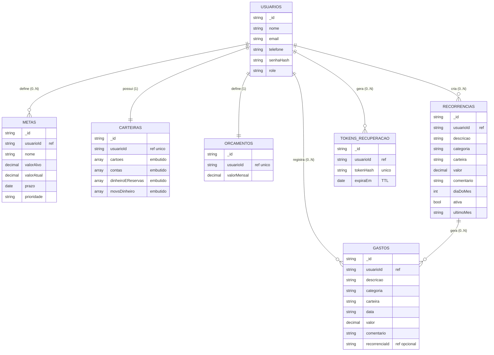

# Modelo de Dados de Objetos — Meu Bolso

> Modelagem orientada a documentos (**MongoDB**). O vocabulário segue o padrão NoSQL: **coleções** (conjunto de documentos), **documentos** (objetos JSON) e relacionamentos por **referência** (guarda-se o `_id` de outro documento) ou **embutido** (o subdocumento é aninhado dentro do documento).
>
> Este documento reflete o modelo **efetivamente implementado** no back-end (Spring Boot + Spring Data MongoDB, pacote `Projeto.MeuBolso.model`). As coleções ainda não implementadas estão listadas à parte, na seção [7. Planejado](#7-planejado-ainda-não-implementado).

## 1. Minimundo (resumo)

O **Meu Bolso** controla a vida financeira de jovens. Cada **usuário** faz login com e-mail e senha e tem um **telefone**. O usuário registra seus **gastos** (classificados por categoria e carteira) e pode definir um **orçamento** mensal (teto de gastos). Gastos que se repetem todo mês são modelados por uma **recorrência**, que gera os lançamentos de forma idempotente. O usuário define **metas** (a reserva é apenas uma meta com nome próprio) e mantém uma **carteira** com seus cartões, contas e dinheiro em espécie. A recuperação de senha usa um **token** temporário cujo hash é guardado com expiração automática (TTL). O **resumo financeiro não é armazenado** — é calculado a partir dos gastos, do orçamento e das metas.

## 2. Visão geral das coleções (implementadas)

| Coleção | Classe | Finalidade |
|---|---|---|
| `usuarios` | `Usuario` | Conta, login, telefone e papel (role). Dono de todos os demais dados. |
| `metas` | `Meta` | Metas e reserva financeira (reserva = meta comum). |
| `carteiras` | `CarteiraUsuario` | Cartões, contas, dinheiro/reservas e movimentações de dinheiro do usuário. |
| `gastos` | `Gasto` | Gastos (saídas) classificados por categoria e carteira. |
| `orcamentos` | `Orcamento` | Teto mensal de gastos; um por usuário. |
| `recorrencias` | `Recorrencia` | Regras de gasto recorrente (repetir todo mês). |
| `tokens_recuperacao` | `TokenRecuperacao` | Token (hash) de recuperação de senha, com expiração via TTL. |

> **Não é coleção:** o **Resumo Financeiro** (calculado a partir de gastos, orçamento e metas).

---

## 3. Coleções, atributos e tipos

### 3.1 `usuarios` (`Usuario`)
| Atributo | Tipo | Descrição |
|---|---|---|
| `_id` | ObjectId/String | Identificador único. |
| `nome` | String | Nome do usuário. |
| `email` | String | E-mail **único** (índice único); normalizado em minúsculas; usado no login. |
| `telefone` | String | Telefone do usuário. |
| `senhaHash` | String | Hash BCrypt da senha (LGPD — nunca em texto puro). |
| `role` | String | Papel de acesso; padrão `"USER"`. |

### 3.2 `metas` (`Meta`)
| Atributo | Tipo | Descrição |
|---|---|---|
| `_id` | ObjectId/String | Identificador único. |
| `usuarioId` | String (ref → `usuarios`, **indexado**) | Dono da meta. |
| `nome` | String | Ex.: "Viagem", "Reserva de emergência". |
| `valorAlvo` | Decimal128 (BigDecimal) | Quanto se quer alcançar. |
| `valorAtual` | Decimal128 (BigDecimal) | Quanto já foi acumulado; nasce em zero. |
| `prazo` | Date (LocalDate) | Data-alvo (pode ser nula). |
| `prioridade` | String | `"alta"`, `"media"` ou `"baixa"`. |

### 3.3 `carteiras` (`CarteiraUsuario`)
| Atributo | Tipo | Descrição |
|---|---|---|
| `_id` | ObjectId/String | Identificador único. |
| `usuarioId` | String (ref → `usuarios`, **único**) | Dono da carteira (uma por usuário). |
| `cartoes` | Array de Objetos (embutido) | Cartões do usuário (estrutura flexível). |
| `contas` | Array de Objetos (embutido) | Contas bancárias (apelido, banco, saldo, posição de destaque). |
| `dinheiroEReservas` | Array de Objetos (embutido) | Dinheiro em espécie e reservas; o dinheiro guarda a contagem por denominação. |
| `movsDinheiro` | Array de Objetos (embutido) | Movimentações do dinheiro em espécie (entradas/saídas). |

> As quatro listas são salvas como subdocumentos flexíveis (`List<Map<String,Object>>`), espelhando o estado da tela de Carteira no front. **Chaves com ponto:** a contagem de cédulas usa chaves como `"0.5"`; o `MappingMongoConverter` está configurado com `setMapKeyDotReplacement("_DOT_")` para permitir pontos em chaves de mapa.

### 3.4 `gastos` (`Gasto`)
| Atributo | Tipo | Descrição |
|---|---|---|
| `_id` | ObjectId/String | Identificador único. |
| `usuarioId` | String (ref → `usuarios`, **indexado**) | Dono do gasto. |
| `descricao` | String | Descrição do gasto. |
| `categoria` | String | Categoria do gasto. |
| `carteira` | String | Carteira/origem do gasto. |
| `data` | String | Data no formato `"AAAA-MM-DD"` (mesmo contrato do front). |
| `valor` | Decimal128 (BigDecimal) | Valor do gasto. |
| `comentario` | String | Comentário livre; padrão `""`. |
| `recorrenciaId` | String (ref → `recorrencias`) \| null | Preenchido quando o gasto nasceu de uma recorrência. |

### 3.5 `orcamentos` (`Orcamento`)
| Atributo | Tipo | Descrição |
|---|---|---|
| `_id` | ObjectId/String | Identificador único. |
| `usuarioId` | String (ref → `usuarios`, **único**) | Dono do orçamento (um por usuário). |
| `valorMensal` | Decimal128 (BigDecimal) | Teto mensal de gastos; padrão zero. |

### 3.6 `recorrencias` (`Recorrencia`)
| Atributo | Tipo | Descrição |
|---|---|---|
| `_id` | ObjectId/String | Identificador único. |
| `usuarioId` | String (ref → `usuarios`, **indexado**) | Dono da recorrência. |
| `descricao` | String | Modelo do lançamento. |
| `categoria` | String | Categoria do gasto gerado. |
| `carteira` | String | Carteira/origem do gasto gerado. |
| `valor` | Decimal128 (BigDecimal) | Valor do gasto recorrente. |
| `comentario` | String | Comentário; padrão `""`. |
| `diaDoMes` | Int | Dia do mês em que o gasto cai. |
| `ativa` | Boolean | Se a recorrência está ativa; padrão `true`. |
| `ultimoMes` | String | Último mês já lançado (`"AAAA-MM"`); torna a geração idempotente. |

### 3.7 `tokens_recuperacao` (`TokenRecuperacao`)
| Atributo | Tipo | Descrição |
|---|---|---|
| `_id` | ObjectId/String | Identificador único. |
| `usuarioId` | String (ref → `usuarios`, **indexado**) | Dono do token. |
| `tokenHash` | String (**único**) | Hash do token (o valor puro só existe no link do e-mail). |
| `expiraEm` | Date (Instant, **TTL**) | Expiração; índice TTL (`expireAfterSeconds = 0`) faz o MongoDB apagar o documento. |

---

## 4. Relacionamentos, cardinalidades e justificativas

| Relacionamento | Cardinalidade | Estratégia | Justificativa |
|---|---|---|---|
| `usuarios` → `metas` | 1 : 0..N | **Referência** (`usuarioId`) | Metas são filtradas por usuário/prioridade/prazo isoladamente. |
| `usuarios` → `carteiras` | 1 : 1 | **Referência** (`usuarioId` único) | Uma carteira por usuário; o conteúdo (cartões/contas/dinheiro) é **embutido** nela. |
| `usuarios` → `gastos` | 1 : 0..N | **Referência** (`usuarioId`) | Gastos crescem indefinidamente; consulta sempre por usuário. |
| `usuarios` → `orcamentos` | 1 : 1 | **Referência** (`usuarioId` único) | Um teto mensal por usuário. |
| `usuarios` → `recorrencias` | 1 : 0..N | **Referência** (`usuarioId`) | Cada regra é consultada e processada isoladamente. |
| `recorrencias` → `gastos` | 1 : 0..N | **Referência** (`recorrenciaId`) | Cada gasto gerado aponta para a regra que o originou. |
| `usuarios` → `tokens_recuperacao` | 1 : 0..N | **Referência** (`usuarioId`) + **TTL** | Tokens temporários, apagados automaticamente ao expirar. |
| `carteiras` → cartões/contas/dinheiro/movs | 1 : 0..N | **Embutido** | Lidos e salvos sempre juntos, como estado único da tela de Carteira. |

### Princípio adotado (embutir vs. referenciar)
- **Embutir** → o conteúdo da `carteira` (cartões, contas, dinheiro/reservas, movimentações de dinheiro), porque é lido e gravado como um bloco único por usuário.
- **Referenciar** → tudo que cresce de forma independente (gastos, metas, recorrências, tokens) ou é único por usuário (orçamento).

### Integridade e consistência com o minimundo
- **Isolamento por usuário:** todo documento carrega `usuarioId`, e o back-end resolve o usuário sempre pelo JWT (`authentication.getName()`), nunca pelo corpo da requisição.
- **Dinheiro:** `BigDecimal` (Decimal128 no MongoDB) em todos os valores monetários, evitando erro de arredondamento.
- **Recorrência idempotente:** `ultimoMes` garante que gerar os lançamentos duas vezes não duplica gastos.
- **Segurança da recuperação:** guarda-se apenas o `tokenHash`; o TTL em `expiraEm` apaga tokens expirados automaticamente.
- **Chaves com ponto:** denominações como `"0.5"` são permitidas via `setMapKeyDotReplacement("_DOT_")`.
- **Resumo financeiro:** calculado em tempo de consulta; **não é persistido**.

---

## 5. Diagrama do modelo (implementado)



## 6. Exemplos de documentos (JSON)

```json
// usuarios
{ "_id": "u1", "nome": "Lucas", "email": "lucas@exemplo.com",
  "telefone": "31999990000", "senhaHash": "$2a$10$...", "role": "USER" }
```

```json
// metas
{ "_id": "m1", "usuarioId": "u1", "nome": "Reserva de emergência",
  "valorAlvo": { "$numberDecimal": "3000.00" },
  "valorAtual": { "$numberDecimal": "900.00" },
  "prazo": "2026-12-31", "prioridade": "alta" }
```

```json
// gastos
{ "_id": "g1", "usuarioId": "u1", "descricao": "Mercado",
  "categoria": "Alimentação", "carteira": "Nubank", "data": "2026-10-16",
  "valor": { "$numberDecimal": "142.90" }, "comentario": "", "recorrenciaId": null }
```

```json
// orcamentos
{ "_id": "o1", "usuarioId": "u1", "valorMensal": { "$numberDecimal": "2000.00" } }
```

```json
// recorrencias
{ "_id": "r1", "usuarioId": "u1", "descricao": "Assinatura de streaming",
  "categoria": "Assinaturas", "carteira": "Nubank",
  "valor": { "$numberDecimal": "27.90" }, "comentario": "",
  "diaDoMes": 14, "ativa": true, "ultimoMes": "2026-10" }
```

```json
// carteiras (conteúdo embutido; chaves de denominação com ponto)
{ "_id": "w1", "usuarioId": "u1",
  "cartoes": [ { "id": "cartao-nubank", "tipo": "cartao", "apelido": "Nubank" } ],
  "contas": [ { "id": "conta-nubank", "tipo": "conta", "apelido": "Nubank",
                "saldo": 1240.0, "posicao": "principal" } ],
  "dinheiroEReservas": [ { "id": "dinheiro-especie", "tipo": "dinheiro",
                           "apelido": "Dinheiro na carteira", "saldo": 180.0,
                           "contagem": { "100": 1, "50": 1, "20": 1, "10": 1 } } ],
  "movsDinheiro": [ { "id": 1, "descricao": "Troco do almoço",
                      "categoria": "Dinheiro", "data": "17 out",
                      "valor": -12.0, "entrada": false } ] }
```

---

## 7. Planejado (ainda não implementado)

As coleções abaixo fazem parte do modelo conceitual do projeto, mas **ainda não existem no back-end**. Serão adicionadas conforme as funcionalidades avançarem:

| Coleção | Finalidade |
|---|---|
| `categorias` | Categorias do usuário como documentos próprios (hoje a categoria é um texto livre em `gastos`/`recorrencias`). |
| `transacoes` | Modelo unificado de entradas/saídas e aportes a metas (hoje há `gastos`; aportes a meta ainda não geram transação). |
| `planejamentosMensais` | Planejamento do mês com itens por categoria. |
| `simulacoes` | Histórico de simulações de decisões/compras. |
| `orientacoesIA` | Perguntas e respostas do assistente de IA. |
| `conteudosInvestimento` | Conteúdo educativo geral sobre investimentos. |
| `conversasWhatsApp` | Estado das conversas no chatbot do WhatsApp. |
